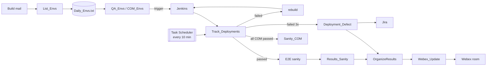

# QA Deployment Automation

Python + Playwright tooling that runs the daily QA deployment cycle of a large
BSS project: dozens of test environments redeployed from Jenkins every day,
sanity-tested end to end, reported to Jira and published to the team's Webex
room — mostly without a human in the loop.

It grew out of real work over about a year, one annoying manual step at a time.
Code comments, console output and test descriptions are in Spanish (my working
language); identifiers and these docs are in English.

> **Note** — this is a sanitized portfolio copy. Hostnames, IPs, ticket ids,
> people and credentials were replaced with placeholders (`example.com`,
> `192.0.2.x`, `QAPRJ-123456`); the logic is untouched and the test suite
> verifies it. It can't talk to the original systems.

## What it automates

| Step | Before | Now |
|---|---|---|
| Turn the "today's builds" mail into a tracking list | copy/paste per env | `List_Envs.py` reads the open Outlook mails |
| Trigger each Jenkins deployment with the right SD file / snapshot | one form at a time | `QA_Envs.py` / `COM_Envs.py`, 6 in parallel |
| Watch the builds, rebuild what failed | refresh Jenkins all day | `Track_Deployments.py`, every 10 min from Task Scheduler |
| Run the E2E sanity (EAST + WEST per env) and collect the billing accounts | 2 forms per env, then read the result | `E2E_Flow1_Till_Billing.py` + `Results_Sanity.py` |
| File a Defect when a deployment keeps failing | read the log, write the ticket | `Deployment_Defect.py` extracts the error and groups identical failures in one ticket |
| Keep the team posted | edit the Webex message by hand | `Webex_Update.py` edits today's messages in place |
| Daily status mail with the Quality-Gate table | Excel + Outlook by hand | `MailQAs.py` / `MailCOMs.py` |

The full flow — every script, every decision, and the gaps that still need a
human — is in **[docs/automation-flow.md](docs/automation-flow.md)**.



## Engineering highlights

- **API first, UI as fallback.** Build status comes from Jenkins' JSON API called
  with `fetch()` *inside* an already-logged-in page (one login per server, no
  extra HTTP client). The DOM is only read when the API fails.
- **Parallel but polite.** `asyncio` + semaphores: 8 status checks, 6 form
  fills, 3 E2E executions at a time, staggered so the target apps don't choke.
- **Decisions, not just clicks.** Rebuilds skip the stages that already passed;
  a build that fails 3× *on the same stages* the same day stops being retried
  and becomes a Defect; identical errors on several envs are merged into one
  ticket (normalised log signature + `SequenceMatcher ≥ 0.92`).
- **Unattended-safe.** Every prompt has a scheduled-run default, zombie Python
  and orphaned Chromium processes are cleaned up on each run, GUI work is
  handed to tasks that run in the user's desktop session.
- **Secrets never touch the code.** Credentials are stored with Windows DPAPI
  (`nc_credentials.py`), Webex uses OAuth with refresh tokens.
- **Office automation over COM** — Excel, Word and Outlook — including the
  quirks (frozen panes, `PrintWindow` screenshots, COM apartments per thread).

## Tests

```bash
pip install -r requirements-dev.txt
pytest
```

The suite was written **before** refactoring anything, against the code as it
ran in production:

- **Golden masters** — real (anonymised) `Daily_Envs.txt` files are run through
  every parser/organizer and compared with the output recorded from the
  original scripts. Any behaviour change shows up as a diff.
- **A fake Playwright page** (`tests/fakes.py`) records every click, wait and
  fill. The Jenkins form flow is compared call-by-call with the original.
- **Regression tests first** — two real bugs were reproduced by a failing test
  before being fixed.
- **Safety net** — an autouse fixture blocks subprocesses, network access and
  `input()`, so a test can never post to Webex or trigger a real deployment.
- **Smoke tests** — every script must compile and import without side effects
  on both production interpreters (3.10 and 3.14).

CI runs the suite on Windows for Python 3.10 and 3.14.

## Layout

```
NTT/                    daily deployment cycle (the scripts Task Scheduler runs live here)
  ntt_config.py         paths and servers shared by every script
  jenkins_web.py        Jenkins helpers shared by QA_Envs / COM_Envs / Track / Defect
  nc_credentials.py     DPAPI-encrypted credential store
  tests/                pytest suite, fixtures and golden masters
GCI/                    offering / device validation reports for another project
docs/                   automation flow and gap analysis
```

## Running it

Windows only (COM automation, DPAPI, Task Scheduler).

```bash
pip install -r requirements.txt
playwright install chromium
py NTT/Setup_Credentials.py      # once: stores the credentials encrypted
py NTT/Track_Deployments.py      # or let Task Scheduler run it
```

`NTT_NOTES_DIR` overrides where `Daily_Envs.txt` lives.

## Security

- No credential is stored in the code or the history: logins live in a Windows DPAPI-encrypted store (`nc_credentials.py`), and only the Windows user that saved them can decrypt them. Webex uses OAuth with refresh tokens.
- `NTT/tests/test_no_sensitive_data.py` fails the build if a private IP, a real user path, a hard-coded password/token, a key-like string or a real email is ever committed.
- Tests can't touch the real world: an autouse fixture blocks subprocesses, network access and `input()`.
