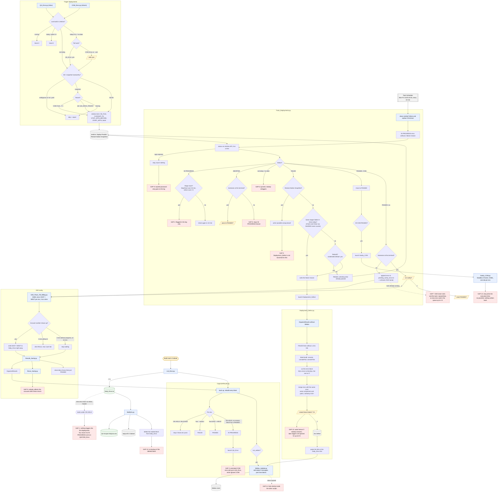
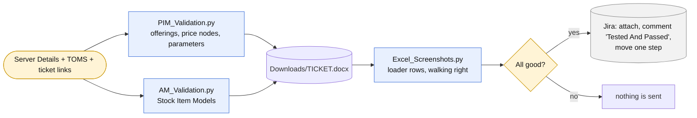

# Automation flow

How the scripts hand work to each other, every decision they take on their
own, and the places where the chain still stops and waits for a person.
Everything here was read from the code (and the Task Scheduler settings), not
from memory.

`Daily_Envs.txt` is the shared state: every script reads it and most of them
write to it. Each block is one build, each line one environment, and the
status header an env sits under (`PASSED`, `IN PROGRESS`, `ON HOLD`,
`FAILED`, `BLOCKED`) is what the next script acts on.

## Daily deployment cycle (NTT)

### Manual tools around the cycle

| Script | What it does | How it's started |
|---|---|---|
| `TS_Sanity.py` | Opens the two PuTTY tunnels, launches Chrome through the SOCKS proxy and runs the TS sanity scope | by hand |
| `SBA.py` / `Divided_SBA.py` | Triggers SBA test builds / uploads split SBA files, collects the report links | by hand |
| `NTTTESTs_Resolve.py` | Resolves a pasted list of NTTTESTS tickets, 5 at a time | by hand |
| `POTs_Ext_Sanities.py` | Prepares (never publishes) the Confluence copies for external sanities | by hand |
| `Ext_Sanities_Screenshots.py` | Alt+S driven screenshot pasting into the sanity sheet | by hand |
| `Setup_Credentials.py` | Stores / lists / deletes the encrypted credentials | by hand |

## GCI validation reports

`GCIBilling.py` writes the billing run-book (FDE / IREP / RRDEP commands) for a
set of accounts; `AutomaticScreenshots.py` is the old Alt+S-to-Word helper;
`filter_probe.py` is a read-only diagnostic for the TOMS filter.

## Gaps — where the chain still waits for a person

| # | Where | What happens today | Idea |
|---|---|---|---|
| 1 | `List_Envs` → `OrganizeResults` | New envs have no status header, so they land under **ON HOLD**. Nothing triggers their first deployment. | Let `List_Envs` write them under IN PROGRESS when the SD file is already in the mail, and call `QA_Envs` / `COM_Envs`. |
| 2 | `OrganizeResults` | ON HOLD → IN PROGRESS promotions always launch `QA_Envs`, which ignores COM envs. Promoted COM envs are never triggered. | Launch `COM_Envs` too when a promoted line is COM (it needs a non-interactive mode first). |
| 3 | `Track_Deployments` | A failed Restore-Eatlon-SnapShot is written as "possible wrong tenant", but `Deployment_Defect` is only launched for other failures. | Decide whether a tenant problem deserves a ticket; if not, at least post it to Webex. |
| 4 | `Track_Deployments` | Stuck stages (Stop/Start > 30 min, others > 2 h) are only flagged in the log. | Post a Webex alert once per stuck build. |
| 5 | `Track_Deployments` | In unattended runs an ABORTED build stays IN PROGRESS and is re-checked every 10 min forever. | After N runs, move it to ON HOLD with a reason. |
| 6 | `Track_Deployments` | Builds that aren't from today (or have no date) are ignored, and nobody retriggers them. | Hand them to `QA_Envs` / `COM_Envs` (they already know how to decide). |
| 7 | `E2E Sanity` task | E2E sleeps forever at the end to keep the browser open; the task policy is *IgnoreNew* with a 4 h limit, so new PASSED envs wait in `pending_sanity_envs.txt` for up to 4 h. | Exit once the accounts are written (or watch the pending file while sleeping). |
| 8 | Unattended `Track_Deployments` | A rejected password stops everything but only shows in the log. | Post to Webex: "run Setup_Credentials". |
| 9 | `Results_Sanity` → `Rerun_Sanity` | Reruns are fired and the script exits; nobody reads the accounts that those reruns produce. | Poll the rerun tabs for a few minutes, or run `Results_Sanity` again after the reruns. |
| 10 | `Deployment_Defect` | Waits for "create these tickets? [Y/n]" with no timeout; later triggers are ignored for up to 8 h meanwhile. | Time out to a Webex summary, or auto-create for well-known errors (Check & Clean Up, SQL). |
| 11 | `Webex_Update` | If the token can't be refreshed it exits with an error that the calling script only prints. | Fall back to a local notification / mail. |
| 12 | `Sanity_COM` | Launches the runs and prints the links; pass/fail is never collected or written back. | Poll the execution pages like E2E does and write the result to Daily_Envs. |
| 13 | `MailQAs` | Deletes the mailed block from `Daily_Envs.txt` without a backup (the other writers do keep one). | Copy the file to `.bak` first, like `OrganizeResults`. |

Also worth a look: `SBA.py` writes to `Documents\QG Scope Analysis.xlsx` while
`MailQAs.py` uses `Documents\NTT\QG Scope Analysis.xlsx`. It was already
like that; if it isn't on purpose, one of them is writing to a stale copy.
